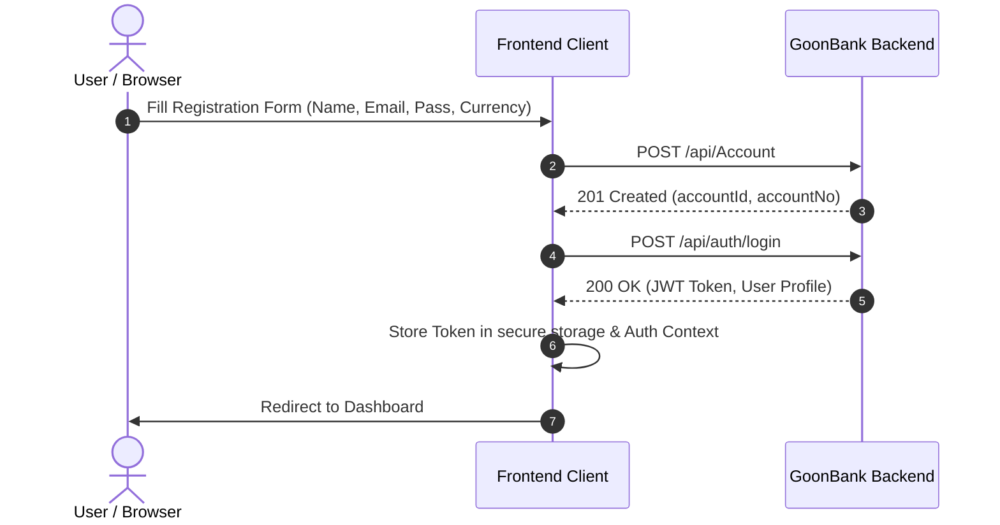
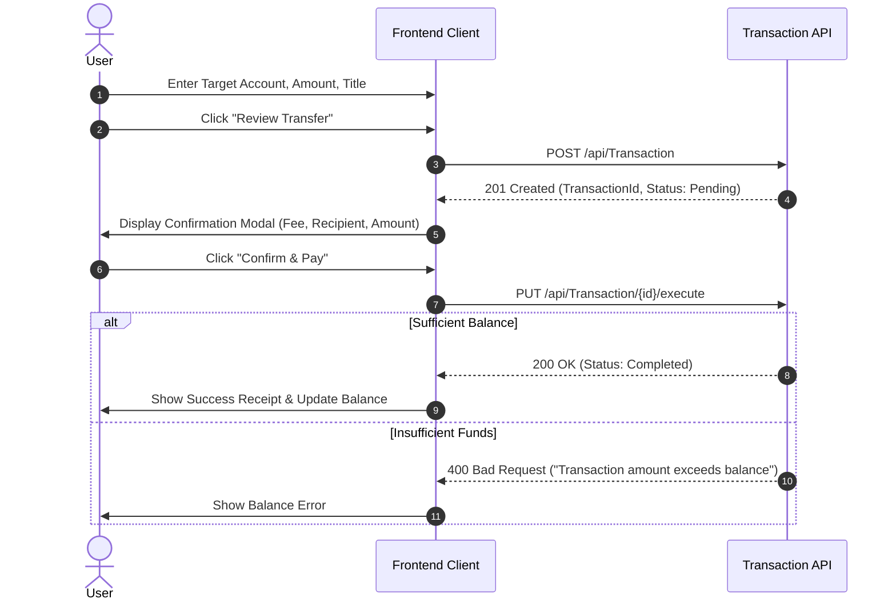
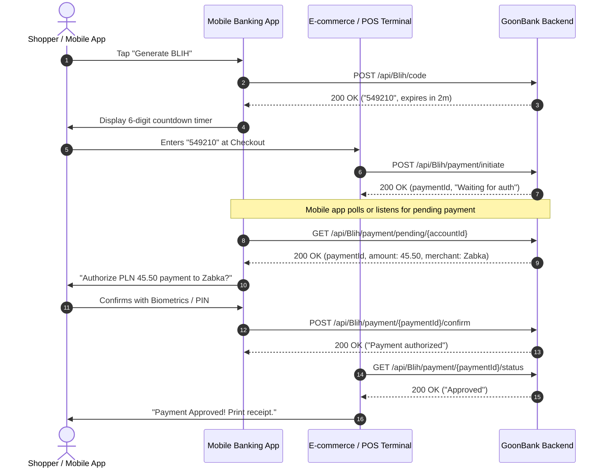

# GoonBank REST API - Frontend Developer Documentation

Welcome to the **GoonBank API documentation**. This guide provides all the information frontend developers (React, Vue, Angular, React Native, Next.js, mobile) need to integrate with the backend services.

---

## Table of Contents
1. [General Information & Setup](#1-general-information--setup)
2. [Authentication & Authorization](#2-authentication--authorization)
3. [Data Enums & Status Codes Reference](#3-data-enums--status-codes-reference)
4. [TypeScript Type Definitions](#4-typescript-type-definitions)
5. [API Endpoints Reference](#5-api-endpoints-reference)
   - [5.1 Authentication (`/api/auth`)](#51-authentication-apiauth)
   - [5.2 Account Management (`/api/Account`)](#52-account-management-apiaccount)
   - [5.3 Money Transactions (`/api/Transaction`)](#53-money-transactions-apitransaction)
   - [5.4 BLIH Mobile Payments & Profile (`/api/BlihProfile` & `/api/Blih`)](#54-blih-mobile-payments--profile-apiblihprofile--apiblih)
   - [5.5 Audit Logs (`/api/audit`)](#55-audit-logs-apiaudit)
   - [5.6 Testing & Dev Utilities (`/api/testing`)](#56-testing--dev-utilities-apitesting)
6. [Core Frontend User Flows](#6-core-frontend-user-flows)
   - [6.1 User Registration & Login](#61-user-registration--login)
   - [6.2 Two-Step Transaction Flow (Create -> Execute)](#62-two-step-transaction-flow-create---execute)
   - [6.3 BLIH Checkout & Customer Approval Flow](#63-blih-checkout--customer-approval-flow)
7. [Error Handling & HTTP Status Codes](#7-error-handling--http-status-codes)

---

## 1. General Information & Setup

### Base URLs
| Environment | Base URL | Protocol |
| :--- | :--- | :--- |
| **Local Development (HTTP)** | `http://localhost:5001` | HTTP |
| **Local Development (HTTPS)** | `https://localhost:7287` | HTTPS |

### Standard Request Headers
For all authenticated endpoints, the client must include the JWT bearer token:
```http
Authorization: Bearer <your_jwt_token>
Content-Type: application/json
Accept: application/json
```

### Standard Response Format
- **Success (200 / 201):** Returns a typed JSON object or array.
- **Client/Server Errors (400, 401, 403, 404, 409):** Most error responses return a standardized error payload:
  ```json
  {
    "message": "Specific error explanation message."
  }
  ```
- **Model Validation Errors (400):** If an invalid payload format is sent (e.g. invalid email format or missing field), ASP.NET Core returns standard validation errors:
  ```json
  {
    "type": "https://tools.ietf.org/html/rfc9110#section-15.5.1",
    "title": "One or more validation errors occurred.",
    "status": 400,
    "errors": {
      "Amount": ["Amount must be greater than 0."],
      "Email": ["The Email field is not a valid e-mail address."]
    }
  }
  ```

---

## 2. Authentication & Authorization

GoonBank uses **JSON Web Tokens (JWT)** for securing endpoints.

1. **Obtaining a Token:** Call `POST /api/auth/login` with your email and password.
2. **Token Lifespan:** Default validity is **120 minutes (2 hours)**. The exact UTC expiration timestamp is returned in `expiresAt`.
3. **Storage Recommendation:** Store the token in memory, secure HTTP-only cookie, or encrypted storage (`localStorage` / `AsyncStorage` / Secure Keystore).
4. **Ownership Verification:** Most private endpoints strictly verify ownership. The `currentUserId` extracted from your JWT token must match the `{id}` or `{accountId}` in the route / body. Accessing another customer's data returns `403 Forbidden`.
5. **Decoded JWT Claims:** The JWT token contains:
   - `nameid` / `sub` / `account_id`: The unique string ID of the account.
   - `email`: User's email.
   - `given_name`: First name.
   - `family_name`: Last name.
   - `role`: Account type (`Checking` or `Savings`).
   - `account_no`: 26-digit account number.
   - `currency`: Default currency (`PLN`, `EUR`, `USD`, etc.).

---

## 3. Data Enums & Status Codes Reference

ASP.NET Core serializes enums as **integers** by default in JSON payloads unless explicitly specified. Use the integer values when sending requests, and refer to the mapped names below.

### 3.1 `AccountType`
| Integer | Name | Description |
| :---: | :--- | :--- |
| `0` | `Checking` | Standard day-to-day transaction account |
| `1` | `Savings` | Savings deposit account |

### 3.2 `AccountStatus`
| Integer | Name | Description |
| :---: | :--- | :--- |
| `0` | `Active` | Normal operating status |
| `1` | `Frozen` | Temporarily locked (cannot initiate transactions) |
| `2` | `Closed` | Permanently closed (balance must be `0.00` to close) |

### 3.3 `TransactionType`
| Integer | Name | Description |
| :---: | :--- | :--- |
| `0` | `Transfer` | Account-to-account funds transfer |
| `1` | `Withdrawal` | ATM cash withdrawal (decreases balance) |
| `2` | `Deposit` | Cash/ATM deposit (increases balance) |
| `3` | `Blih` | BLIH contactless / merchant payment |

### 3.4 `TransactionStatus`
| Integer | Name | Description |
| :---: | :--- | :--- |
| `0` | `Pending` | Created, waiting for user execution or cancellation |
| `1` | `Completed` | Successfully executed and balances updated |
| `2` | `Failed` | Cancelled by user or rejected (insufficient funds, etc.) |

### 3.5 `BlihProfileStatus`
| Integer | Name | Description |
| :---: | :--- | :--- |
| `0` | `Active` | BLIH active on account |
| `1` | `Disabled` | BLIH disabled |

### 3.6 `BlihCodeStatus`
| Integer | Name | Description |
| :---: | :--- | :--- |
| `0` | `Active` | Available for payment (valid for 2 minutes) |
| `1` | `Used` | Consumed by a merchant terminal |
| `2` | `Expired` | Timed out after 2 minutes or invalidated by a new code |

### 3.7 `BlihPaymentStatus`
| Integer | Name | Description |
| :---: | :--- | :--- |
| `0` | `Pending` | Initiated by merchant, awaiting customer PIN/approval |
| `1` | `Approved` | Authorized by customer, funds transferred |
| `2` | `Failed` | Rejected by customer, insufficient funds, or timed out |

### 3.8 `AuditEntityType`
| Integer | Name | Description |
| :---: | :--- | :--- |
| `0` | `Unknown` | Unclassified entity |
| `1` | `Customer` | Customer profile modifications |
| `2` | `Account` | Bank account status or creation |
| `3` | `Transaction` | General money transfer or deposit |
| `4` | `BlihTransaction` | BLIH code or merchant transaction |
| `5` | `Card` | Card entity (future support) |
| `6` | `Session` | Login / Logout activity |

### 3.9 `AuditAction`
| Integer | Name |
| :---: | :--- |
| `0` | `Create` |
| `1` | `Update` |
| `2` | `Delete` |
| `3` | `Read` |

---

## 4. TypeScript Type Definitions

Copy and paste this into your frontend project (e.g. `src/types/api.ts`):

```typescript
// ==================== Enums ====================
export enum AccountType {
  Checking = 0,
  Savings = 1
}

export enum AccountStatus {
  Active = 0,
  Frozen = 1,
  Closed = 2
}

export enum TransactionType {
  Transfer = 0,
  Withdrawal = 1,
  Deposit = 2,
  Blih = 3
}

export enum TransactionStatus {
  Pending = 0,
  Completed = 1,
  Failed = 2
}

export enum BlihProfileStatus {
  Active = 0,
  Disabled = 1
}

export enum BlihCodeStatus {
  Active = 0,
  Used = 1,
  Expired = 2
}

export enum BlihPaymentStatus {
  Pending = 0,
  Approved = 1,
  Failed = 2
}

export enum AuditEntityType {
  Unknown = 0,
  Customer = 1,
  Account = 2,
  Transaction = 3,
  BlihTransaction = 4,
  Card = 5,
  Session = 6
}

export enum AuditAction {
  Create = 0,
  Update = 1,
  Delete = 2,
  Read = 3
}

export enum ActorType {
  Customer = 0,
  Employee = 1,
  System = 2
}

// ==================== Auth DTOs ====================
export interface LoginRequest {
  email: string;
  password: string; // Plaintext or SHA-256 lowercase hex
}

export interface AuthResponse {
  token: string;
  expiresAt: string; // ISO 8601 string
  accountId: string;
  email: string;
  firstName: string;
  lastName: string;
  accountNo: string;
  currency: string;
  balance: number;
  accountType: AccountType;
}

// ==================== Account DTOs ====================
export interface CreateAccountRequest {
  firstName: string;
  lastName: string;
  email: string;
  passwordHash: string; // Plaintext or 64-char SHA-256 hex string
  dateOfBirth: string; // Format: "YYYY-MM-DD"
  currency: string; // Exactly 3 chars, e.g. "PLN"
  accountType: AccountType;
}

export interface AccountResponse {
  accountId: string;
  firstName: string;
  lastName: string;
  email: string;
  dateOfBirth: string; // "YYYY-MM-DD"
  accountNo: string;
  currency: string;
  balance: number;
  accountType: AccountType;
  status: AccountStatus;
  openedAt: string;
  createdAt: string;
  closedAt: string | null;
}

// ==================== Transaction DTOs ====================
export interface CreateTransactionRequest {
  sourceAccountId: string;
  targetAccountId?: string | null; // Required for Transfer
  amount: number; // Max 2 decimal places, > 0
  transactionType: TransactionType;
  description?: string;
}

export interface MoneyTransaction {
  transactionId: string;
  sourceAccountId: string;
  targetAccountId: string | null;
  amount: number;
  type: TransactionType;
  status: TransactionStatus;
  title: string;
  createdAt: string;
}

// ==================== BLIH DTOs ====================
export interface CreateBlihProfileRequest {
  accountId: string;
  phoneHash: string; // 64-character SHA-256 hex string of phone number
}

export interface BlihProfile {
  blihProfileId: string;
  accountId: string;
  phoneHash: string;
  status: BlihProfileStatus;
  registeredAt: string;
}

export interface GenerateBlihCodeRequest {
  accountId: string;
}

export interface BlihCodeResponse {
  code: string; // 6 digits, e.g. "549210"
  expiresAt: string; // ISO 8601 string (2 min validity)
}

export interface InitiateBlihPaymentRequest {
  blihCode: string;
  merchantId: string;
  amount: number;
}

export interface InitiateBlihPaymentResponse {
  paymentId: string;
  message: string;
}

export interface PendingBlihPayment {
  blihPaymentId: string;
  amount: number;
  merchantId: string;
  initiatedAt: string;
}

export interface BlihPaymentStatusResponse {
  status: "Pending" | "Approved" | "Failed";
}

// ==================== Audit DTOs ====================
export interface AuditLog {
  auditId: string;
  actorIdentityId: string | null;
  actorType: ActorType;
  customerId: string | null;
  entityType: AuditEntityType;
  entityId: string;
  action: AuditAction;
  occurredAt: string;
  correlationId: string | null;
  ipAddress: string | null;
  detailsJson: string | null;
}

// ==================== Common Messages ====================
export interface SimpleMessageResponse {
  message: string;
}
```

---

## 5. API Endpoints Reference

### 5.1 Authentication (`/api/auth`)

---

#### `POST /api/auth/login`
Authenticates a user and issues a Bearer JWT Token.

- **Authentication:** None (`[AllowAnonymous]`)
- **Headers:** `Content-Type: application/json`
- **Request Body:**
  ```json
  {
    "email": "jan.kowalski@example.com",
    "password": "SecretPassword123!"
  }
  ```
- **Notes on Password:** The frontend can supply the plain password or a SHA-256 64-character lowercase hex string. If plain text is supplied, the backend computes SHA-256 automatically.
- **Response 200 OK:**
  ```json
  {
    "token": "eyJhbGciOiJIUzI1NiIsInR5cCI6IkpXVCJ9...",
    "expiresAt": "2026-11-18T11:52:00Z",
    "accountId": "a90df189-e137-43f1-bdce-6c24b918b939",
    "email": "jan.kowalski@example.com",
    "firstName": "Jan",
    "lastName": "Kowalski",
    "accountNo": "58129384918293847291829384",
    "currency": "PLN",
    "balance": 1500.00,
    "accountType": 0
  }
  ```
- **Error Responses:**
  - `401 Unauthorized`: `{"message": "Invalid email or password."}`
  - `401 Unauthorized`: `{"message": "Account is not active (status: Frozen)."}`

---

#### `GET /api/auth/me`
Retrieves full profile and live balance of the currently authenticated account.

- **Authentication:** `Bearer <token>`
- **Response 200 OK:**
  ```json
  {
    "accountId": "a90df189-e137-43f1-bdce-6c24b918b939",
    "firstName": "Jan",
    "lastName": "Kowalski",
    "email": "jan.kowalski@example.com",
    "dateOfBirth": "1992-05-15",
    "accountNo": "58129384918293847291829384",
    "currency": "PLN",
    "balance": 1500.00,
    "accountType": 0,
    "status": 0,
    "openedAt": "2026-11-18T09:00:00Z",
    "createdAt": "2026-11-18T09:00:00Z",
    "closedAt": null
  }
  ```
- **Error Responses:**
  - `401 Unauthorized`: Token missing, malformed, or expired.
  - `404 Not Found`: `{"message": "Account not found."}`

---

#### `POST /api/auth/logout`
Terminates the user's session and records a `Session` audit log.

- **Authentication:** `Bearer <token>`
- **Response 200 OK:**
  ```json
  {
    "message": "Logged out successfully."
  }
  ```
- **Error Responses:**
  - `401 Unauthorized`: Missing or invalid token.

---

### 5.2 Account Management (`/api/Account`)

---

#### `POST /api/Account`
Registers a new bank account and generates a 26-digit account number.

- **Authentication:** None (`[AllowAnonymous]`)
- **Headers:** `Content-Type: application/json`
- **Request Body Fields:**
  | Field | Type | Required | Constraints | Description |
  | :--- | :--- | :---: | :--- | :--- |
  | `firstName` | `string` | Yes | 1 - 100 characters | User's first name |
  | `lastName` | `string` | Yes | 1 - 100 characters | User's last name |
  | `email` | `string` | Yes | Valid email format | Unique email address |
  | `passwordHash` | `string` | Yes | Plaintext or 64-char Hex | User password |
  | `dateOfBirth` | `string` | Yes | `YYYY-MM-DD`, cannot be future | Date of birth |
  | `currency` | `string` | Yes | Exactly 3 characters (e.g. `PLN`, `EUR`) | Account currency |
  | `accountType` | `number` | Yes | `0` (Checking), `1` (Savings) | Account type |

- **Request Example:**
  ```json
  {
    "firstName": "Jan",
    "lastName": "Kowalski",
    "email": "jan.kowalski@example.com",
    "passwordHash": "Secret123!",
    "dateOfBirth": "1992-05-15",
    "currency": "PLN",
    "accountType": 0
  }
  ```
- **Response 201 Created:** Returns `AccountResponse` with HTTP `Location` header pointing to `/api/Account/{id}`.
  ```json
  {
    "accountId": "a90df189-e137-43f1-bdce-6c24b918b939",
    "firstName": "Jan",
    "lastName": "Kowalski",
    "email": "jan.kowalski@example.com",
    "dateOfBirth": "1992-05-15",
    "accountNo": "58129384918293847291829384",
    "currency": "PLN",
    "balance": 0.0,
    "accountType": 0,
    "status": 0,
    "openedAt": "2026-11-18T09:00:00Z",
    "createdAt": "2026-11-18T09:00:00Z",
    "closedAt": null
  }
  ```
- **Error Responses:**
  - `400 Bad Request`: `{"message": "Date of birth cannot be in the future."}`
  - `409 Conflict`: `{"message": "An account with this email address already exists."}`

---

#### `GET /api/Account/{id}`
Retrieves details for a specific bank account.

- **Authentication:** `Bearer <token>`
- **Security Check:** Authenticated account ID must match `{id}`. Otherwise returns `403 Forbid`.
- **Response 200 OK:**
  ```json
  {
    "accountId": "a90df189-e137-43f1-bdce-6c24b918b939",
    "firstName": "Jan",
    "lastName": "Kowalski",
    "email": "jan.kowalski@example.com",
    "dateOfBirth": "1992-05-15",
    "accountNo": "58129384918293847291829384",
    "currency": "PLN",
    "balance": 1250.00,
    "accountType": 0,
    "status": 0,
    "openedAt": "2026-11-18T09:00:00Z",
    "createdAt": "2026-11-18T09:00:00Z",
    "closedAt": null
  }
  ```
- **Error Responses:**
  - `403 Forbidden`: Trying to inspect an account ID that is not yours.
  - `404 Not Found`: Account does not exist.

---

#### `GET /api/Account/{id}/transactions`
Returns a paginated list of all incoming and outgoing transactions for the account, sorted with most recent first.

- **Authentication:** `Bearer <token>`
- **Query Parameters:**
  | Parameter | Type | Default | Constraints | Description |
  | :--- | :---: | :---: | :---: | :--- |
  | `page` | `integer` | `1` | `>= 1` | Page number |
  | `pageSize` | `integer` | `50` | `1 - 200` | Number of records per page (capped at 200) |
- **Example Request:** `GET /api/Account/a90df189-e137-43f1-bdce-6c24b918b939/transactions?page=1&pageSize=20`
- **Response 200 OK:**
  ```json
  [
    {
      "transactionId": "9b1deb4d-3b7d-4bad-9bdd-2b0d7b3dcb6d",
      "sourceAccountId": "a90df189-e137-43f1-bdce-6c24b918b939",
      "targetAccountId": "fae214d4-5b4a-4e1b-8719-74d12c8a2b10",
      "amount": 150.00,
      "type": 0,
      "status": 1,
      "title": "Apartment utilities payment",
      "createdAt": "2026-11-18T09:30:00Z"
    }
  ]
  ```
- **Error Responses:**
  - `403 Forbidden`: If `{id}` does not match authenticated token.
  - `404 Not Found`: If account is not found.

---

#### `PATCH /api/Account/{id}/status`
Updates account status (`Active = 0`, `Frozen = 1`, `Closed = 2`).

- **Authentication:** `Bearer <token>`
- **Headers:** `Content-Type: application/json`
- **Request Body (Raw integer):**
  ```json
  1
  ```
- **Business Rules:**
  - A closed account (`2`) **cannot** be reopened.
  - To close an account (`newStatus = 2`), the account balance **must be exactly 0.00**.
- **Response 200 OK:**
  ```json
  {
    "message": "Account status changed to Frozen."
  }
  ```
- **Error Responses:**
  - `400 Bad Request`: `{"message": "Cannot change the status of a closed account."}`
  - `400 Bad Request`: `{"message": "Cannot close an account with an active balance. Please withdraw or transfer remaining funds first."}`
  - `403 Forbidden`: Authenticated user does not match `{id}`.

---

### 5.3 Money Transactions (`/api/Transaction`)

---

#### `POST /api/Transaction`
Creates a transaction in `Pending` (`0`) state.

> [!IMPORTANT]
> Creating a transaction **does not immediately transfer funds or alter account balances**. Transactions are created in `Pending` state and must be committed via `PUT /api/Transaction/{id}/execute` (or cancelled via `POST /api/Transaction/{id}/cancel`).

- **Authentication:** `Bearer <token>`
- **Request Body Fields:**
  | Field | Type | Required | Constraints | Description |
  | :--- | :--- | :---: | :--- | :--- |
  | `sourceAccountId` | `string` | Yes | Must match authenticated user ID | Debited account |
  | `targetAccountId` | `string` | Conditional | Required for `Transfer` (`0`), must != `sourceAccountId` | Beneficiary account |
  | `amount` | `number` | Yes | `0.01` to `1,000,000,000.00`, max 2 decimals | Transaction amount |
  | `transactionType` | `number` | Yes | `0` (Transfer), `1` (Withdrawal), `2` (Deposit) | Type of transaction |
  | `description` | `string` | No | Max 200 characters | Payment title / description |

- **Request Example (Transfer):**
  ```json
  {
    "sourceAccountId": "a90df189-e137-43f1-bdce-6c24b918b939",
    "targetAccountId": "fae214d4-5b4a-4e1b-8719-74d12c8a2b10",
    "amount": 250.00,
    "transactionType": 0,
    "description": "Invoice #482 payment"
  }
  ```
- **Request Example (Cash ATM Deposit):**
  ```json
  {
    "sourceAccountId": "a90df189-e137-43f1-bdce-6c24b918b939",
    "amount": 1000.00,
    "transactionType": 2,
    "description": "Cash ATM deposit"
  }
  ```
- **Response 201 Created:**
  ```json
  {
    "transactionId": "7c88b021-3958-45be-9a99-b148d451a9b2",
    "sourceAccountId": "a90df189-e137-43f1-bdce-6c24b918b939",
    "targetAccountId": "fae214d4-5b4a-4e1b-8719-74d12c8a2b10",
    "amount": 250.0,
    "type": 0,
    "status": 0,
    "title": "Invoice #482 payment",
    "createdAt": "2026-11-18T09:40:00Z"
  }
  ```
- **Error Responses:**
  - `400 Bad Request`: `{"message": "Cross-currency transfers are not supported. Source: PLN, Target: EUR."}`
  - `400 Bad Request`: `{"message": "Source account is not active (status: Frozen)."}`
  - `400 Bad Request`: `{"message": "Target account not found."}`
  - `403 Forbidden`: If `sourceAccountId` is not the authenticated user.

---

#### `PUT /api/Transaction/{id}/execute`
Executes a `Pending` transaction, validates balances atomically, and updates balances.

- **Authentication:** `Bearer <token>`
- **Security Check:** Caller must be the owner of `sourceAccountId`.
- **Response 200 OK:**
  ```json
  {
    "transactionId": "7c88b021-3958-45be-9a99-b148d451a9b2",
    "sourceAccountId": "a90df189-e137-43f1-bdce-6c24b918b939",
    "targetAccountId": "fae214d4-5b4a-4e1b-8719-74d12c8a2b10",
    "amount": 250.0,
    "type": 0,
    "status": 1,
    "title": "Invoice #482 payment",
    "createdAt": "2026-11-18T09:40:00Z"
  }
  ```
- **Error Responses:**
  - `400 Bad Request`: `{"message": "Transaction amount exceeds account balance."}`
  - `400 Bad Request`: `{"message": "BLIH transactions must be executed through the BLIH payment flow."}`
  - `403 Forbidden`: Authenticated user does not own this transaction.
  - `404 Not Found`: `{"message": "Transaction with ID ... not found."}`
  - `409 Conflict`: `{"message": "Transaction is already Completed."}` (Double-execution safeguard).

---

#### `GET /api/Transaction/{id}`
Fetches details of a single transaction.

- **Authentication:** `Bearer <token>`
- **Security Check:** Caller must be either `sourceAccountId` or `targetAccountId`.
- **Response 200 OK:** Returns `MoneyTransaction` object.
- **Error Responses:**
  - `403 Forbidden`: Caller is not a participant in this transaction.
  - `404 Not Found`: Transaction does not exist.

---

#### `POST /api/Transaction/{id}/cancel`
Cancels a pending transaction and sets its status to `Failed` (`2`).

- **Authentication:** `Bearer <token>`
- **Security Check:** Caller must be `sourceAccountId`.
- **Response 200 OK:**
  ```json
  {
    "message": "Transaction cancelled successfully."
  }
  ```
- **Error Responses:**
  - `400 Bad Request`: `{"message": "Cannot cancel a transaction that is already Completed."}`

---

#### `PATCH /api/Transaction/{id}`
Manually updates the status of a pending transaction (cannot be used to set status to `Completed`).

- **Authentication:** `Bearer <token>`
- **Request Body (Raw integer):** e.g. `2` (Failed)
- **Response 200 OK:**
  ```json
  {
    "message": "Transaction status changed to Failed."
  }
  ```
- **Error Responses:**
  - `400 Bad Request`: `{"message": "Transactions can only be completed via the execution endpoint."}`
  - `400 Bad Request`: `{"message": "Cannot modify status of a transaction that is already Completed."}`

---

### 5.4 BLIH Mobile Payments & Profile (`/api/BlihProfile` & `/api/Blih`)

BLIH is an instant, one-time-code mobile payment system (equivalent to Polish BLIK).

```
[Customer App]                      [Merchant Terminal / Webstore]
      |                                           |
 1. Generate 6-digit Code (valid 2m)              |
      | -------- Displays Code to User -------->  |
      |                                           |
      |                                    2. POST /payment/initiate
      |                                       (blihCode, amount)
      |                                           |
 3. Poll /payment/pending/{accountId}             |
      |<---------- Prompt displayed -------------|
 4. POST /payment/{id}/confirm                    |
      |                                    5. Poll /payment/{id}/status
      |                                       (Approved!)
```

---

#### `POST /api/BlihProfile`
Enables BLIH on the customer's account by registering their hashed phone number.

- **Authentication:** `Bearer <token>`
- **Request Body:**
  ```json
  {
    "accountId": "a90df189-e137-43f1-bdce-6c24b918b939",
    "phoneHash": "e3b0c44298fc1c149afbf4c8996fb92427ae41e4649b934ca495991b7852b855"
  }
  ```
- **Notes on `phoneHash`:** Calculate the SHA-256 hex string of the normalized phone number (e.g. `+48123456789`).
- **Response 200 OK:**
  ```json
  {
    "blihProfileId": "0912ab8e-8849-410a-bfa1-e407fcf4bca9",
    "accountId": "a90df189-e137-43f1-bdce-6c24b918b939",
    "phoneHash": "e3b0c44298fc1c149afbf4c8996fb92427ae41e4649b934ca495991b7852b855",
    "status": 0,
    "registeredAt": "2026-11-18T09:15:00Z"
  }
  ```
- **Error Responses:**
  - `400 Bad Request`: `{"message": "Cannot register BLIH profile for inactive account (status: Frozen)."}`
  - `409 Conflict`: `{"message": "Account already has a BLIH profile."}`
  - `409 Conflict`: `{"message": "Phone number is already linked to an active BLIH profile."}`

---

#### `GET /api/BlihProfile/{accountId}`
Checks if an account has an active BLIH profile.

- **Authentication:** `Bearer <token>`
- **Response 200 OK:** Returns `BlihProfile` object.
- **Error Responses:**
  - `404 Not Found`: `{"message": "BLIH profile for account ... not found."}`

---

#### `POST /api/Blih/code`
Generates a random 6-digit BLIH code valid for **2 minutes**.

- **Authentication:** `Bearer <token>`
- **Request Body:**
  ```json
  {
    "accountId": "a90df189-e137-43f1-bdce-6c24b918b939"
  }
  ```
- **Behavior:** Automatically marks any previous unused codes for this profile as `Expired`.
- **Response 200 OK:**
  ```json
  {
    "code": "481920",
    "expiresAt": "2026-11-18T09:54:30.123Z"
  }
  ```
- **Error Responses:**
  - `400 Bad Request`: `{"message": "Customer has not enabled BLIH or profile is not active."}`
  - `400 Bad Request`: `{"message": "No active bank account associated with this customer."}`

---

#### `POST /api/Blih/payment/initiate`
Initiated by an e-commerce checkout or physical store terminal when the shopper enters a 6-digit BLIH code.

- **Authentication:** None (`[AllowAnonymous]`)
- **Request Body:**
  ```json
  {
    "blihCode": "481920",
    "merchantId": "STORE_ZABKA_01",
    "amount": 45.50
  }
  ```
- **Response 200 OK:**
  ```json
  {
    "paymentId": "34f19b22-871d-4074-b4a1-0941d65011f0",
    "message": "Waiting for customer authorization."
  }
  ```
- **Error Responses:**
  - `400 Bad Request`: `{"message": "Invalid or expired BLIH code."}`
  - `400 Bad Request`: `{"message": "BLIH profile is not active."}`

---

#### `GET /api/Blih/payment/pending/{accountId}`
Called by the customer's mobile/web app to check for incoming payment authorization requests.

- **Authentication:** `Bearer <token>`
- **Security Check:** Caller ID must match `{accountId}`.
- **Response 200 OK:**
  ```json
  {
    "blihPaymentId": "34f19b22-871d-4074-b4a1-0941d65011f0",
    "amount": 45.50,
    "merchantId": "STORE_ZABKA_01",
    "initiatedAt": "2026-11-18T09:53:00Z"
  }
  ```
- **Error Responses:**
  - `404 Not Found`: `{"message": "No pending payments found."}`
  - `404 Not Found`: `{"message": "Pending payment has expired."}` (If > 2 minutes old).

---

#### `POST /api/Blih/payment/{paymentId}/confirm`
The customer authorizes and completes the payment. Deducts customer balance and automatically creates a formal completed `MoneyTransaction` in their history.

- **Authentication:** `Bearer <token>`
- **Security Check:** Authenticated user must be the payer of the payment.
- **Response 200 OK:**
  ```json
  {
    "message": "Payment authorized successfully."
  }
  ```
- **Error Responses:**
  - `400 Bad Request`: `{"message": "Insufficient funds."}`
  - `400 Bad Request`: `{"message": "Payment authorization has timed out."}`
  - `400 Bad Request`: `{"message": "Payment not found or already processed."}`
  - `403 Forbidden`: Authenticated user is not the designated payer.

---

#### `POST /api/Blih/payment/{paymentId}/reject`
Customer rejects the pending payment request.

- **Authentication:** `Bearer <token>`
- **Response 200 OK:**
  ```json
  {
    "message": "Payment rejected by user."
  }
  ```
- **Error Responses:**
  - `400 Bad Request`: Payment already processed or not found.
  - `403 Forbidden`: User is not the payer.

---

#### `GET /api/Blih/payment/{paymentId}/status`
Allows the merchant checkout screen to poll payment status until approved or failed.

- **Authentication:** None (`[AllowAnonymous]`)
- **Response 200 OK:**
  ```json
  {
    "status": "Approved"
  }
  ```
  *(Possible values: `"Pending"`, `"Approved"`, `"Failed"`)*
- **Error Responses:**
  - `404 Not Found`: If `paymentId` does not exist.

---

### 5.5 Audit Logs (`/api/audit`)

---

#### `GET /api/audit`
Retrieves activity and security audit history for the authenticated user.

- **Authentication:** `Bearer <token>`
- **Query Parameters:**
  | Parameter | Type | Default | Description |
  | :--- | :---: | :---: | :--- |
  | `page` | `integer` | `1` | Page number (min 1) |
  | `pageSize` | `integer` | `50` | Results per page (1 - 200) |
  | `entityType` | `integer` | `null` | Filter by `AuditEntityType` enum (e.g. `6` for Sessions) |
- **Response 200 OK:**
  ```json
  [
    {
      "auditId": "c9284210-91a3-4ff3-982c-490b4ad20129",
      "actorIdentityId": null,
      "actorType": 0,
      "customerId": "a90df189-e137-43f1-bdce-6c24b918b939",
      "entityType": 6,
      "entityId": "a90df189-e137-43f1-bdce-6c24b918b939",
      "action": 0,
      "occurredAt": "2026-11-18T09:05:00Z",
      "correlationId": null,
      "ipAddress": null,
      "detailsJson": "{\"Action\":\"UserLogin\"}"
    }
  ]
  ```

---

#### `GET /api/audit/all`
Fetches system-wide audit logs across all users (Restricted to **Development Mode**).

- **Authentication:** None (`[AllowAnonymous]`) in Development.
- **Query Parameters:** `page`, `pageSize`, `entityType`.
- **Response 200 OK:** Returns array of all `AuditLog` entities.
- **Error Responses:**
  - `403 Forbidden`: `{"message": "Viewing all audit logs is restricted to Development mode."}`

---

### 5.6 Testing & Dev Utilities (`/api/testing`)

> [!CAUTION]
> These endpoints are only active when `ASPNETCORE_ENVIRONMENT=Development`. In production environments, they will respond with `403 Forbidden`.

#### `POST /api/testing/reset`
Wipes all data from database tables (`Accounts`, `Transactions`, `BlihCodes`, `BlihPayments`, `BlihProfiles`, `AuditLogs`).

- **Authentication:** None (`[AllowAnonymous]`)
- **Response 200 OK:**
  ```json
  {
    "message": "Database reset successfully. All accounts, transactions, blih records, and audit logs have been deleted."
  }
  ```

---

#### `DELETE /api/testing/accounts/{id}`
Deletes a single test account and cascades through all associated BLIH profiles, codes, payments, transactions, and audit logs.

- **Authentication:** None (`[AllowAnonymous]`)
- **Response 200 OK:**
  ```json
  {
    "message": "Account a90df189-e137-43f1-bdce-6c24b918b939 and all related records have been deleted."
  }
  ```
- **Error Responses:**
  - `404 Not Found`: `{"message": "Account with ID ... not found."}`

---

## 6. Core Frontend User Flows

### 6.1 User Registration & Login



1. Call `POST /api/Account` with registration parameters.
2. Call `POST /api/auth/login` to obtain the JWT token and user profile.
3. Attach `Authorization: Bearer <token>` to all subsequent requests.
4. Call `GET /api/auth/me` on application boot to restore session state.

---

### 6.2 Two-Step Transaction Flow (Create -> Execute)

All money transfers, cash deposits, and withdrawals use a two-step confirmation pattern:



---

### 6.3 BLIH Checkout & Customer Approval Flow



#### Frontend Implementation Tips for BLIH:
1. **Timer UI:** When calling `POST /api/Blih/code`, start a 120-second circular countdown bar based on `expiresAt`.
2. **Polling for Authorization:** In the banking app, once a code has been generated, poll `GET /api/Blih/payment/pending/{accountId}` every 2 to 3 seconds until a payment prompt appears.
3. **Merchant Terminal Polling:** In merchant checkouts, poll `GET /api/Blih/payment/{paymentId}/status` every 2 seconds until the status changes from `"Pending"` to `"Approved"` or `"Failed"`.

---

## 7. Error Handling & HTTP Status Codes

| HTTP Status | Meaning | Typical Scenarios & Suggested Frontend Handling |
| :---: | :--- | :--- |
| `200 OK` | Success | Request succeeded. Parse payload. |
| `201 Created` | Resource Created | Account registered or transaction created. Check `Location` header or response body. |
| `400 Bad Request` | Business Validation Failed | Insufficient funds, invalid date of birth, currency mismatch, expired BLIH code, etc. Display `message` directly in an error alert/toast. |
| `401 Unauthorized` | Not Authenticated | Missing, invalid, or expired JWT token. Clear client token and redirect user to `/login`. |
| `403 Forbidden` | Access Denied | Authenticated user is trying to access/modify another customer's account or transactions. Display "You are not authorized to view this resource." |
| `404 Not Found` | Not Found | Resource ID does not exist or pending BLIH payment expired. |
| `409 Conflict` | Resource Conflict | Duplicate email address, phone hash already linked to an active BLIH profile, or double-execution of a transaction. |
| `500 Internal Error` | Server Exception | Unhandled backend exception. Show generic "Something went wrong, please try again later" toast. |

### Axios Interceptor Example (TypeScript / JavaScript)
```typescript
import axios from 'axios';

export const apiClient = axios.create({
  baseURL: 'http://localhost:5001',
  headers: {
    'Content-Type': 'application/json',
  },
});

// Request interceptor: Automatically attach token
apiClient.interceptors.request.use((config) => {
  const token = localStorage.getItem('auth_token');
  if (token) {
    config.headers.Authorization = `Bearer ${token}`;
  }
  return config;
});

// Response interceptor: Global error handling
apiClient.interceptors.response.use(
  (response) => response,
  (error) => {
    if (error.response?.status === 401) {
      // Token expired or invalid
      localStorage.removeItem('auth_token');
      window.location.href = '/login';
    }
    return Promise.reject(error);
  }
);
```
